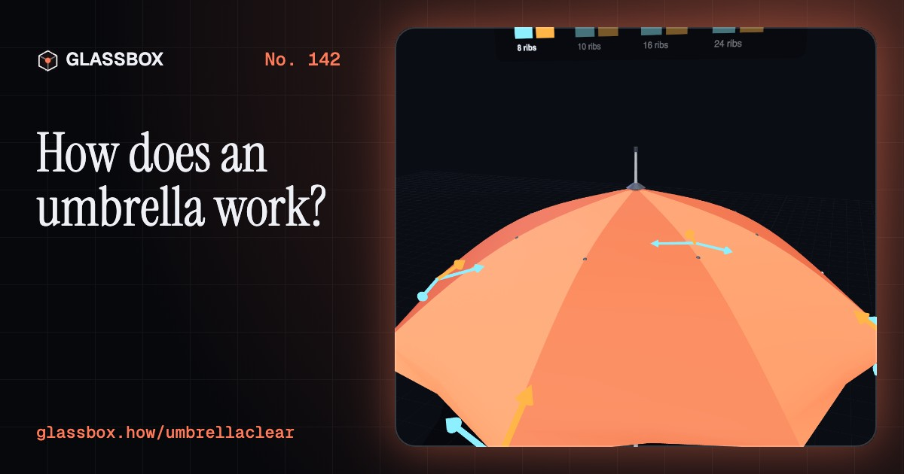
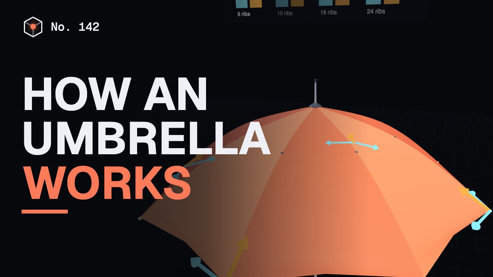
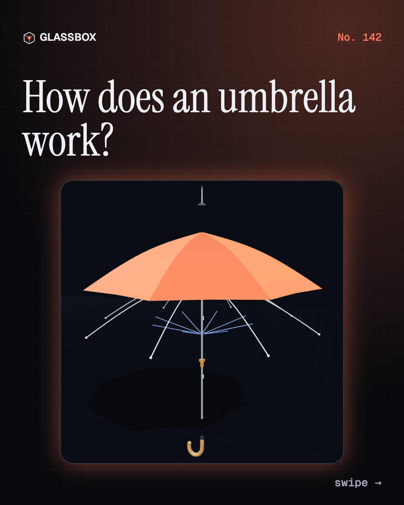
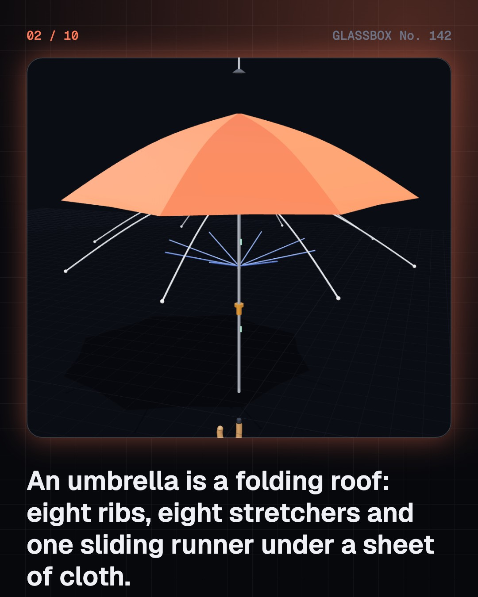
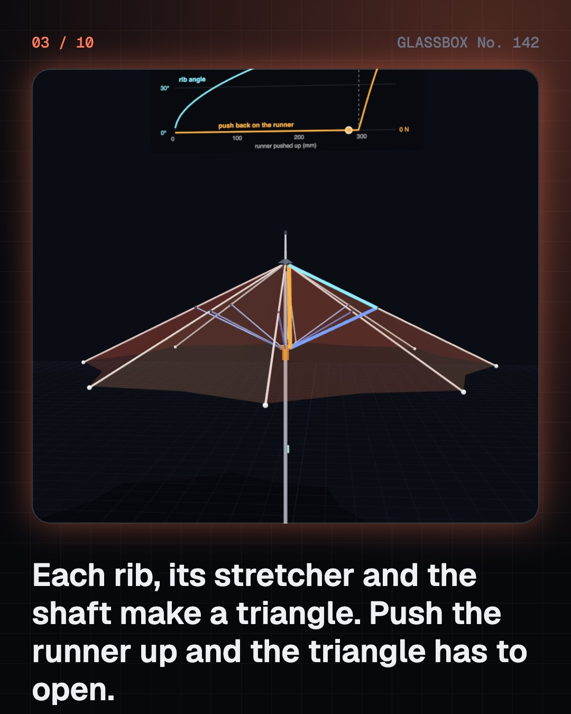
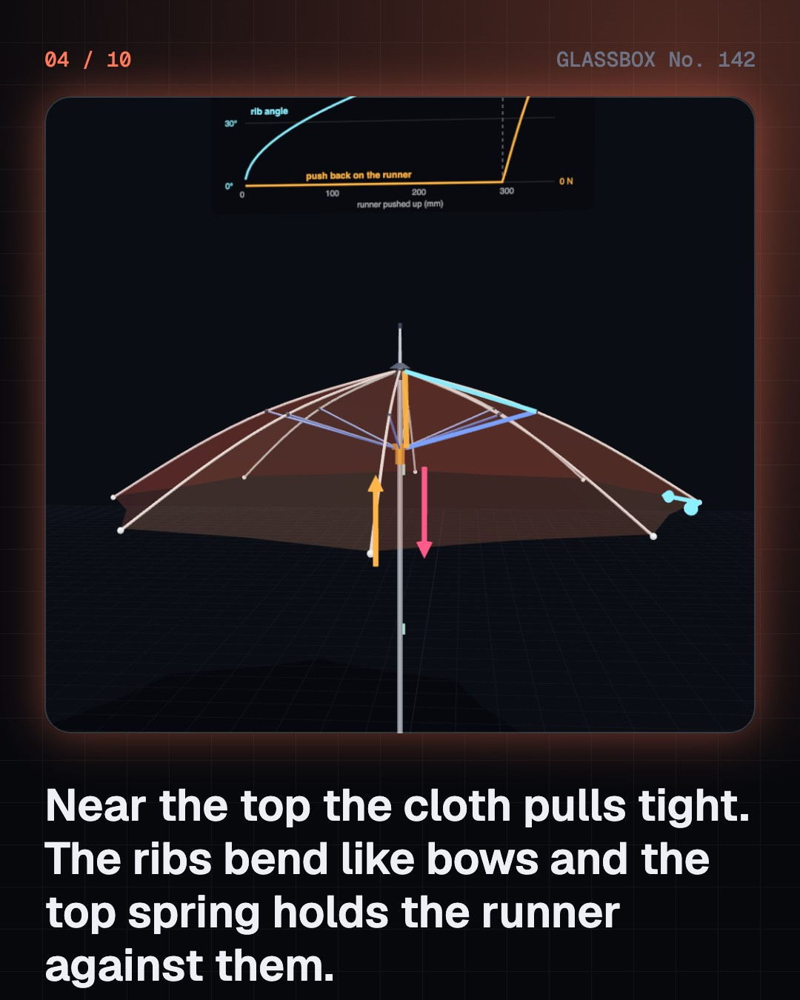

<!-- glassbox:start -->
<!-- Generated from glassbox.json by the Glassbox hub (npm run readme -- umbrellaclear). Edit glassbox.json, not this block. -->
<p align="center"><a href="https://glassbox.how/e/umbrellaclear/"></a></p>

<h1 align="center">UmbrellaClear</h1>

<p align="center"><b>How does an umbrella work?</b><br>Push one sleeve up a stick and eight ribs swing out, bend like bows and pull a sheet of cloth drum tight. Open an umbrella in 3D, work its linkage, and see why the wind turns it inside out.</p>

<p align="center"><a href="https://glassbox.how/umbrellaclear/"><b>▶ Play with it</b></a> &nbsp;·&nbsp; <a href="https://glassbox.how/e/umbrellaclear/">Read the 60-second explainer</a> &nbsp;·&nbsp; <a href="https://glassbox.how/umbrellaclear/glassbox/reel.mp4">Watch the 40-second video</a></p>

<p align="center">
  <a href="https://glassbox.how/e/umbrellaclear/"></a>
  <a href="https://glassbox.how/e/umbrellaclear/"></a>
  <a href="LICENSE"></a>
  <a href="LICENSE-CONTENT.md"></a>
  <a href="#privacy"></a>
</p>

## In 60 seconds

1. **A folding roof on a stick.** An umbrella is a shaft, eight thin ribs hinged at the top, eight stretchers that hinge on one sliding runner, and a canopy sewn from eight cloth panels. Two sprung catches in the shaft hold it open or shut.
2. **One push opens eight ribs.** Each rib, its stretcher and the shaft make a triangle. Pushing the runner up shortens the shaft side, so the joint has to swing out. All eight triangles share the runner, so all eight ribs open together.
3. **Cloth pulls, ribs push.** The cloth is cut a little small. Near the top it pulls tight, the ribs bend like bows, and the top spring holds the runner against them. Cloth in tension and ribs in bending and compression make a stiff, light roof. More ribs are rounder and stronger, and heavier.
4. **Rain slants, so tilt the shaft.** A 2 mm raindrop falls at about 6.5 m/s, so a 20 km/h breeze pushes rain about 40 degrees off straight down. The dry space under the canopy leans the same way. Lean the umbrella into the wind and the dry space swings back over you. A water-repellent finish makes drops bead and roll off.
5. **Why it turns inside out.** Drag grows with the square of wind speed, and a cup catches nearly four times as much air as a dome. When wind gets under the canopy it lifts the outer ribs. Past the cloth's hold they bow and snap through. Vents and springy fibreglass ribs help.
6. **The one that fits in a bag.** A pocket umbrella has a telescopic shaft and ribs in three hinged sections. A short link and a long wire on every rib make two small linkages that unfold all three sections in step. It packs to under a third of the length, with nine hinges per rib instead of three.

## Words worth knowing

| Term | Meaning |
|---|---|
| **Rib** | One of the long thin bars that hold the cloth out. It hinges on the top notch at the top of the shaft. |
| **Stretcher** | The shorter bar from the runner to the middle of a rib. It pushes the rib outwards. |
| **Runner** | The sleeve that slides on the shaft and carries every stretcher. Its height sets the angle of every rib. |
| **Linkage** | Stiff bars joined by pins so that moving one part moves all the others in a fixed way. |
| **Tension structure** | A structure kept in shape by parts that are pulled tight, like a tent, a kite or an umbrella canopy. |
| **Drag** | The force of moving air on an object. It grows with the square of the wind speed and depends on shape and area. |
| **Snap-through** | A sudden jump of a bent part from one curved shape to the opposite one. It is how an umbrella turns inside out. |
| **Rain angle** | How far rain slants from straight down. Its tangent is the wind speed divided by the drops' fall speed. |
| **Telescopic shaft** | A shaft made of tubes that slide inside each other, so a folding umbrella can pack short. |

## A short history

**4,500 years from a shade held over kings to a storm-proof canopy that folds into your bag.**

- **250 BCE** · The chhatra crowns the Great Stupa (Emperor Ashoka's builders, and later the Shungas, Sanchi, Madhya Pradesh, India)
- **21** · A folding umbrella for an emperor's carriage (Wang Mang's craftsmen, China)
- **220** · Oiled paper keeps off the rain (Chinese umbrella makers, China)
- **1710** · A pocket umbrella in Paris (Jean Marius, Paris, France)
- **1750** · The man who dared to carry one (Jonas Hanway, London, England)
- **1852** · The Paragon rib (Samuel Fox, Stocksbridge, Yorkshire, England)
- **1928** · The Knirps (Hans Haupt and Fritz Bremshey, Berlin and Solingen, Germany)
- **1929** · A sculptor's umbrella for a handbag (Slawa Horowitz (later Duldig), Vienna, Austria)

The full story, with 28 moments, charts, people and 42 sources: [glassbox.how/e/umbrellaclear/history](https://glassbox.how/e/umbrellaclear/history/). The data lives in [`history.json`](history.json).

## Video and slides

Made with the Glassbox studio from this box's storyboard (`window.glassbox.director`). Free to reuse under CC BY 4.0.

<a href="https://glassbox.how/umbrellaclear/glassbox/video.mp4"></a>

<p><a href="glassbox/slide-1.jpg"></a> <a href="glassbox/slide-2.jpg"></a> <a href="glassbox/slide-3.jpg"></a> <a href="glassbox/slide-4.jpg"></a></p>

| File | What | Size |
|---|---|---|
| [`glassbox/reel.mp4`](https://glassbox.how/umbrellaclear/glassbox/reel.mp4) | Reel / Short, with captions and soundtrack | 1080×1920 |
| [`glassbox/video.mp4`](https://glassbox.how/umbrellaclear/glassbox/video.mp4) | YouTube video, with captions and soundtrack | 1920×1080 |
| `glassbox/slide-1…10.jpg` | Instagram carousel | 1080×1350 |
| `glassbox/thumb.jpg` | YouTube thumbnail | 1280×720 |
| `glassbox/cover.jpg` | Share card and repo social preview | 1200×630 |
| [`glassbox/history-reel.mp4`](https://glassbox.how/umbrellaclear/glassbox/history-reel.mp4) | “History in 10 moments” Reel / Short | 1080×1920 |
| `glassbox/history-slide-*.jpg` | History carousel | 1080×1350 |
| `glassbox/post.json` | Post copy and schedule used by the publish kit | |

## Privacy

This box has no accounts and no ads, and it ships its own fonts and libraries. When you run it yourself it sends nothing anywhere. On glassbox.how, the site's `/bar.js` also loads Glassbox's analytics: **Google Analytics** to count visits (it asks first in the EU, UK and Switzerland, and stays off when your browser sends Global Privacy Control or Do Not Track) and **ClickTrust** to detect bots.

It remembers a few things **in your own browser only**, and never sends them anywhere:

| Browser storage key | What it holds |
|---|---|
| `umbrellaclear.v1` | Which chapters you have opened, your best quiz scores, and sound on or off. |

Exactly what each one sees is at [glassbox.how/privacy](https://glassbox.how/privacy/).

## Licences

- **Code:** [MIT](LICENSE). Use it, change it, ship it.
- **Explanations, text, images and videos** (`glassbox.json`, `glassbox/`): [CC BY 4.0](LICENSE-CONTENT.md). Credit “Glassbox, glassbox.how/e/umbrellaclear”.
- **Third-party parts** keep their own licences: [three.js](https://threejs.org) (MIT), [Geist, Instrument Serif](https://openfontlicense.org) (SIL OFL 1.1).
- The Glassbox name and logo aren't covered by either licence. See the [terms](https://glassbox.how/terms/).

Found a mistake? [Open an issue](https://github.com/bdeeps/umbrellaclear/issues). Corrections happen in public.
<!-- glassbox:end -->

## Run it

It's plain HTML, CSS and JavaScript. No build step and no dependencies. Run locally, it contacts no other website.

```bash
python3 -m http.server 8000
```

Three.js and the fonts ship in `vendor/` and `fonts/`, so it also works offline.

Then open http://localhost:8000.

## How it's built

| File | What |
|---|---|
| `index.html`, `css/app.css` | The page and its styles |
| `js/app.js`, `js/stage.js`, `js/ui.js`, `js/kit.js` | The shared Glassbox 3D engine: chapters, 3D stage, controls, quiz, video director |
| `js/chapters/*.js` | One file per chapter: the 3D model, controls, text, key terms, quiz and video scenes |
| `js/umbrella.js` | The umbrella models shared by the chapters: the rib-and-stretcher linkage solved from its pin joints, the bent-rib and taut-cloth sums, rain and wind physics, the stick umbrella and the three-fold umbrella |
| `glassbox.json` | Title, question, explainer beats, key terms, browser storage and credits shown on glassbox.how |
| `reel` in each chapter | The storyboard the Glassbox studio records into short videos |
| `glassbox/` | The published video, slides, thumbnail and post copy |
| `fonts/`, `vendor/three/` | Self-hosted Geist and Instrument Serif (SIL OFL 1.1) and three.js (MIT) |
